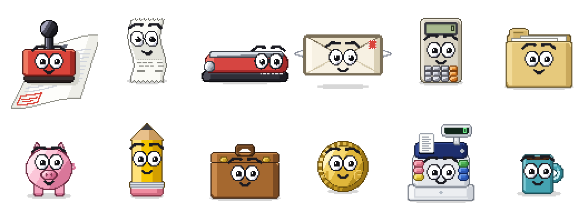

# pixel-mascot

[](https://www.npmjs.com/package/pixel-mascot) [](LICENSE)

Procedural pixel-art mascots for the web, in the style of the old Office assistants. There are no
sprite images: every frame is computed from signed distance functions, fifteen times a second, so a
character can hop, tilt, squash, blink and wear any hat without anyone drawing those frames.



It started as the assistant of [Sumalos](https://www.pablofr.com/blog/pixel-art-ai-assistant), an
invoicing tool, where the character's mood follows a language model's chat: it thinks while the
request is in flight, talks while the answer streams, and looks sad when it fails. The engine knows
nothing about AI, though. Any app can drive it.

- **11 characters:** a rubber stamp, a till receipt, a stapler, an envelope with wings, a calculator,
  a ring binder, a piggy bank, a pencil, a briefcase, a euro coin and a cash register.
- **8 moods and 23 gestures**, each character with one signature move of its own.
- **28 accessories** in three slots (head, face, neck) that fit every character.
- **Eyes that follow the pointer**, blinking, fidgets when idle, and a nap after 45 seconds alone.
- **No dependencies.** TypeScript, a `<canvas>`, and nothing else.

Try them all in the [live demos](https://www.pablofr.com/blog/pixel-art-ai-assistant), or run the
example in this repo (below).

## Install

```sh
npm install pixel-mascot
```

It ships ES modules with type declarations and has no dependencies. The animator needs a browser
(`<canvas>`, `requestAnimationFrame`); `renderFrame` and the frame helpers also run in Node, which is
how the sprite-sheet script below works.

## Quick start

```ts
import { Animator, pum } from "pixel-mascot";

const canvas = document.querySelector("canvas")!;
const mascot = new Animator(canvas, pum);

mascot.outfit = { head: "top-hat", face: "none", neck: "bow-tie" };
mascot.play("hop");

// Tie it to whatever your app is doing.
mascot.setMood("thinking"); // waiting for a reply
mascot.setMood("talking"); // the reply is arriving
mascot.setMood("idle");
mascot.play("happy");

// When the canvas goes away.
mascot.destroy();
```

The canvas is 144 × 134 pixels. Show it at a whole multiple so the pixels stay square:

```css
canvas {
  width: 288px;
  height: 268px;
  image-rendering: pixelated;
}
```

The rows at the top of the canvas are kept clear for a speech balloon: pull your balloon down over
them (Sumalos overlaps it by 16px) and the character's symbols stay visible underneath.

## The animator

`new Animator(canvas, character)` sizes the canvas, starts drawing at 15 frames a second, and
follows the pointer with its eyes. It stops drawing while the tab is hidden, and with
`prefers-reduced-motion` it holds still.

| Method | What it does |
| --- | --- |
| `setMood(mood)` | Holds a resting state until the next one. |
| `play(gesture)` | Plays a gesture once, waking the character if it was asleep. |
| `sleep()` | Falls asleep and stays asleep until a gesture or mood wakes it. |
| `exit()` / `enter()` | Walks out through a door that rises from the floor, or comes back in. Both return a promise. |
| `gazeAt({ x, y })` | Looks at a point on the screen instead of the pointer; `null` lets go. |
| `outfit` | `{ head, face, neck }`, each an accessory id or `"none"`. Read on every frame. |
| `destroy()` | Stops drawing and removes its listeners. |

**Moods** (`MOODS`): `idle`, `attentive`, `thinking`, `talking`, `sleeping`, `eager`, `hungry`,
`working`. The last three come from file uploads: eager while a file is dragged anywhere on the page,
hungry with its mouth open when the file is right over it, working while it uploads.

**Gestures** (`GESTURE_NAMES`): `hop`, `action` (the character's signature move), `surprise`,
`wink`, `happy`, `lookAround`, `stretch`, `dance`, `nod`, `gulp`, `angry`, `sad`, `love`, `dizzy`,
`laugh`, `scared`, `cool`, `celebrate`, `think`, `confused`, `tickle`, `disco`, `shake`.

**Accessories** (`WARDROBE`):

| Slot | Ids |
| --- | --- |
| `head` | `visor`, `top-hat`, `party`, `cap`, `crown`, `beret`, `cowboy`, `santa`, `hard-hat`, `ear-defenders`, `long-wig`, `headphones` |
| `face` | `glasses`, `sunglasses`, `monocle`, `magnifier`, `3d`, `mask`, `mustache`, `blush`, `eye-patch` |
| `neck` | `bow-tie`, `tie`, `scarf`, `medal`, `pearls`, `bandana`, `lanyard` |

## Drawing frames yourself

The animator is a convenience. Underneath, `renderFrame` draws one pose into a pixel buffer, and
`gestureFrame` / `moodFrame` give you the pose for any moment of any animation, with no clock. That is
enough to build a sprite sheet, a still, or your own animation loop:

```ts
import { CANVAS_H, CANVAS_W, gestureFrame, NO_OUTFIT, pum, renderFrame } from "pixel-mascot";

const pixels = new Uint32Array(CANVAS_W * CANVAS_H);
const layer = new Uint32Array(CANVAS_W * CANVAS_H);

// The top of Pum's hop, 40% of the way through.
renderFrame(pixels, layer, pum.art, gestureFrame(pum, "hop", 0.4), NO_OUTFIT);
ctx.putImageData(new ImageData(new Uint8ClampedArray(pixels.buffer), CANVAS_W, CANVAS_H), 0, 0);
```

Or render a whole sheet to a PNG from the command line, no browser needed:

```sh
npm run sheet -- pum                                  # a built-in character
npm run sheet -- examples/characters/mug.ts           # your own
npm run sheet -- calcu --scale 1 --outfit head:crown,neck:tie
```

## Make your own character

A character is one function that takes a point and returns a colour. The guide walks through a
complete one, a coffee mug, from an empty file to a finished character with its own signature move,
and ends with a prompt you can give an AI to draft one for you:

**[docs/creating-characters.md](docs/creating-characters.md)**

## Run the example

```sh
npm install
npm run dev
```

It opens a page with every character plus the guide's mug, and pickers for mood, outfit and gesture.

## Performance

Each frame samples every pixel of the canvas, in JavaScript, on the main thread. Measured on an
Apple M1 Pro with Bun 1.4.3, averaging 200 frames after 20 to warm up, one frame costs 3.6 to 8.3 ms
bare and 7.9 to 13 ms wearing a hat, glasses and a bow tie, depending on the character. At 15 frames a
second the budget is 66.7 ms, so one character is cheap. A page with a dozen at once would not be.

## Credits

Inspired by [Florian Kiem's Windows XP experiment](https://floriankiem.com/experiments?demo=windows-xp),
and of course by Microsoft's [Office Assistant](https://en.wikipedia.org/wiki/Office_Assistant). Clippy
is Microsoft's and is not included. The story of how it was built is in
[Building a Pixel-Art AI Assistant](https://www.pablofr.com/blog/pixel-art-ai-assistant).

## License

[MIT](LICENSE)
